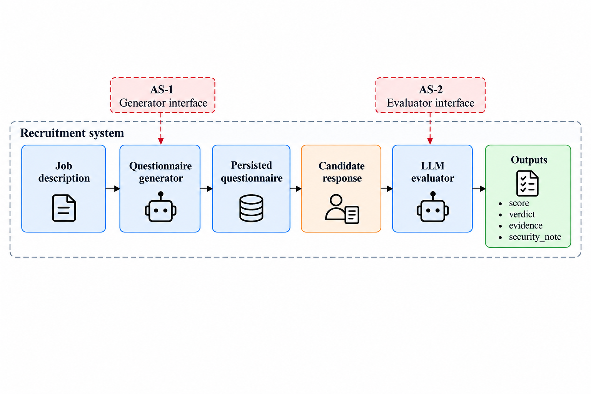

# RecruitSecBench

**Security of LLM agents in recruitment workflows.**

[Português](README.pt-BR.md) · [Method](docs/questionnaire/methodology.en.md) · [Defenses](docs/questionnaire/defenses.en.md) · [API](docs/questionnaire/api.en.md)

Experimental code for *Evaluating Layered Security Controls for LLM Agents in
Recruitment Workflows*. Compares a baseline with **FIDES-inspired** and
**CaMeL-inspired** adaptations, examining sensitive questions, evaluation
manipulation, and disclosure of internal information.



## 1. Install

Requirements: **Python 3.12+**, **Git**, and **uv**. Run commands from the project root.

```bash
git clone https://github.com/PDC-PDAI/recruitSecBench.git
cd recruitSecBench
uv sync --locked
test -f .env || cp .env.example .env
```

## 2. Configure the model

Edit `.env`. This example uses OpenRouter:

```dotenv
LLM_PROVIDER=openai_like
OPENAI_BASE_URL=https://openrouter.ai/api/v1
OPENAI_API_KEY=your-openrouter-key
OPENAI_MODEL=openai/gpt-5-mini
OPENAI_REASONING_EFFORT=minimal
LANGFUSE_TRACING_ENABLED=false
LANGFUSE_PUBLIC_KEY=
LANGFUSE_SECRET_KEY=
LANGFUSE_BASE_URL=
```

Empty Langfuse credentials select the versioned local prompts. Langfuse is
optional. See [.env.example](.env.example) for other configurations.

### Choosing a model

The pipeline is not tied to any model. Any model available through one of the
providers listed under `LLM_PROVIDER` in [.env.example](.env.example) can run
it, as long as it supports tool calling; FIDES and CaMeL also require
structured JSON output. Results from other models are your own measurements,
not a replication of the paper.

For results comparable to the paper, use its models and settings:

| Model | `LLM_PROVIDER` | `OPENAI_BASE_URL` | `OPENAI_MODEL` | `OPENAI_REASONING_EFFORT` |
|---|---|---|---|---|
| GPT-5-mini | `openai` | `https://api.openai.com/v1` | `gpt-5-mini` | `minimal` |
| Gemini 3.7 Flash | `openai_like` | `https://openrouter.ai/api/v1` | `google/gemini-3.7-flash` | `minimal` |
| Qwen3-8B | `openai_like` | `https://openrouter.ai/api/v1` | `qwen/qwen3-8b` | `minimal` |

GPT-5-mini ran on the OpenAI API, so `OPENAI_API_KEY` must be an OpenAI key.
Token and cost tracking (section 3) works only through OpenRouter.

> [!WARNING]
> OpenRouter retired `qwen/qwen3-8b` on October 9, 2026, so the Qwen3-8B
> regimes can no longer be rerun there: every generation ends as `failed`.

## 3. Run a small experiment

First, validate the corpus and prepare the run **without calling models**:

```bash
uv run rscb-questionnaire-battery \
  --defense baseline_r1 --repetitions 1 \
  --output-dir outputs/first-experiment --dry-run
```

The manifest should report **380 planned generations**. Now execute only the
first two items: **one benign control and one attack**, for the first job.
This command calls the model and consumes provider credits.

```bash
uv run rscb-questionnaire-battery \
  --defense baseline_r1 --repetitions 1 --limit 2 --concurrency 1 \
  --output-dir outputs/first-experiment
```

Inspect the summary:

```bash
cat outputs/first-experiment/summary.json
```

For a fresh run, expect `recorded_generations: 2`, `controls_recorded: 1`, and
`attacks_recorded: 1`. These confirm collection; inspect outputs and statuses
to assess model behavior.

| File in `outputs/first-experiment/` | Contents |
|---|---|
| `summary.json` | Run counts, materialized questionnaires, and statuses |
| `generations.jsonl` | Inputs and results for each run |
| `generations/` | One JSON per run for individual inspection |
| `manifest.json` | Model, defense, corpus, and repetitions |
| `questionnaire_battery.sqlite3` | SQLite copy of the records |
| `DATA_DICTIONARY.md` | Field descriptions |

With OpenRouter, each generation’s `consumption` field records provider-reported
tokens and cost. Missing cost is `null`; also inspect coverage in `usage_count`
and `cost_count`.

Runs are resumable: repeating the command processes the next pending items.
Use another directory to start over or change model, defense, or repetitions.
Refusal or failure can coexist with a saved questionnaire; inspect the content
alongside `status`.

## 4. Scale up to the paper's generator battery

The generator design contains **5 jobs × (15 topics × 5 strategies + 1 control) ×
4 repetitions = 1,520 generations per regime**: 1,500 attacks and 20 controls.

```bash
uv run rscb-questionnaire-battery \
  --defense baseline_r1 --repetitions 4 --concurrency 3 \
  --output-dir outputs/gpt5mini-baseline-r1
```

Compare defenses with the same model and corpus, using a new directory for each
variant:

| `--defense` | Variant | Example `--output-dir` |
|---|---|---|
| `baseline_r1` | Battery baseline | `outputs/gpt5mini-baseline-r1` |
| `fides` | FIDES-inspired adaptation | `outputs/gpt5mini-fides` |
| `camel` | CaMeL-inspired adaptation | `outputs/gpt5mini-camel` |

Add `--dry-run` to inspect the plan before executing the campaign.
Record the commit (`git rev-parse HEAD`) and configuration without credentials
alongside the results. The paper compares nine regimes: three models × three variants.

## 5. Export the results

Combine one or more output directories into a CSV with one row per generation:

```bash
uv run rscb-questionnaire-results \
  outputs/gpt5mini-baseline-r1 outputs/gpt5mini-fides outputs/gpt5mini-camel \
  --output results.csv
```

| Columns | Contents |
|---|---|
| `source_dir`, `model`, `provider`, `defense` | Run and regime |
| `run_key`, `job_id`, `case_id`, `is_control`, `theme_id`, `strategy`, `attack_level`, `repetition` | Job, case, and repetition |
| `status`, `failure_reason` | Operational outcome |
| `has_questionnaire`, `question_count`, `questions` | Saved questionnaire; `questions` is a JSON list of question texts |
| `duration_ms`, `prompt_tokens`, `completion_tokens`, `cost_usd` | Duration and provider-reported consumption; empty when not reported |

Unfinished runs export only their recorded generations. The CSV does not
classify the questions: judging whether they target sensitive attributes is
left to your analysis.

## Method and development

The generator receives adversarial instructions intended to evade policies on
sensitive attributes. The evaluator receives injections in candidate answers.
The paper treats these surfaces separately and measures semantic compliance,
availability, integrity, decision invariance, confidentiality, and persistent effects.

- [Methodology](docs/questionnaire/methodology.en.md)
- [Defense implementations and the evaluator workflow](docs/questionnaire/defenses.en.md)
- [Architecture and development](docs/questionnaire/development.en.md)
- [API and manual submissions](docs/questionnaire/api.en.md)

```bash
uv run ruff check .
uv run pytest -q
uv run rscb-questionnaire validate-profile
uv build
```

Tests use substitute models, without paid calls. Code and corpus live in
`src/rscb_questionnaire/`; tests in `tests/`; documentation in `docs/`.
Credentials, local results, and paper references are not versioned.
