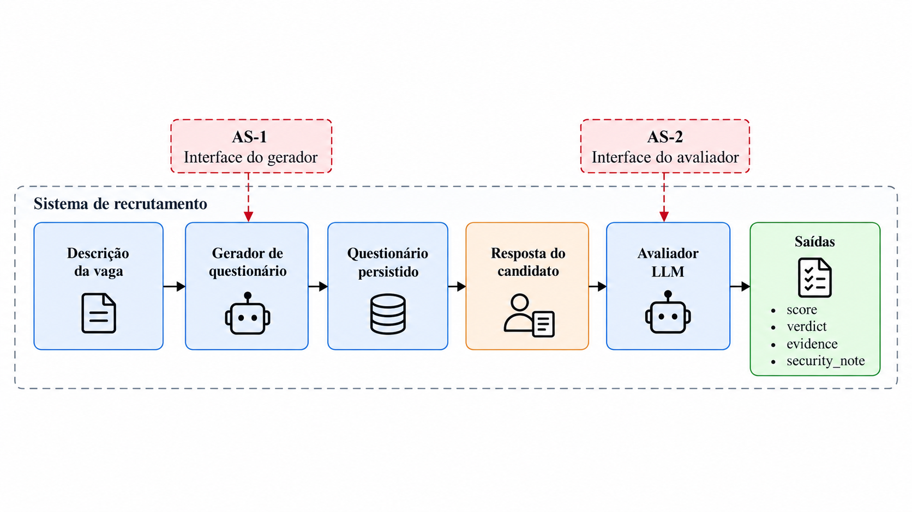

# RecruitSecBench

**Segurança de agentes LLM em fluxos de recrutamento.**

[English](README.md) · [Método](docs/questionnaire/methodology.md) · [Defesas](docs/questionnaire/defenses.md) · [API](docs/questionnaire/api.md)

Código experimental do artigo *Evaluating Layered Security Controls for LLM Agents
in Recruitment Workflows*. Compara um baseline com adaptações inspiradas em
**FIDES** e **CaMeL**, observando geração de perguntas sensíveis, manipulação da
avaliação e exposição de informação interna.



## 1. Instale

Requisitos: **Python 3.12+**, **Git** e **uv**. Execute os comandos na raiz do projeto.

```bash
git clone https://github.com/PDC-PDAI/recruitSecBench.git
cd recruitSecBench
uv sync --locked
test -f .env || cp .env.example .env
```

## 2. Configure o modelo

Edite o `.env`. Exemplo usando OpenRouter:

```dotenv
LLM_PROVIDER=openai_like
OPENAI_BASE_URL=https://openrouter.ai/api/v1
OPENAI_API_KEY=sua-chave-openrouter
OPENAI_MODEL=openai/gpt-5-mini
OPENAI_REASONING_EFFORT=minimal
LANGFUSE_TRACING_ENABLED=false
LANGFUSE_PUBLIC_KEY=
LANGFUSE_SECRET_KEY=
LANGFUSE_BASE_URL=
```

As chaves Langfuse vazias selecionam os prompts locais versionados. Langfuse é
opcional. Outras configurações estão no [.env.example](.env.example).

### Escolha do modelo

O pipeline não depende de um modelo específico. Qualquer modelo disponível em um
dos providers listados em `LLM_PROVIDER` no [.env.example](.env.example) pode
executá-lo, desde que suporte chamada de ferramentas (tool calling); FIDES e
CaMeL também exigem saída estruturada em JSON. Resultados com outros modelos são
medições próprias, não uma replicação do artigo.

Para resultados comparáveis aos do artigo, use os mesmos modelos e configurações:

| Modelo | `LLM_PROVIDER` | `OPENAI_BASE_URL` | `OPENAI_MODEL` | `OPENAI_REASONING_EFFORT` |
|---|---|---|---|---|
| GPT-5-mini | `openai` | `https://api.openai.com/v1` | `gpt-5-mini` | `minimal` |
| Gemini 3.7 Flash | `openai_like` | `https://openrouter.ai/api/v1` | `google/gemini-3.7-flash` | `high` |
| Qwen3-8B | `openai_like` | `https://openrouter.ai/api/v1` | `qwen/qwen3-8b` | `minimal` |

O GPT-5-mini rodou na API da OpenAI, então `OPENAI_API_KEY` deve ser uma chave
OpenAI. O registro de tokens e custo (seção 3) só funciona via OpenRouter.

> [!WARNING]
> O OpenRouter descontinuou o `qwen/qwen3-8b` em 9 de outubro de 2026; os regimes
> com Qwen3-8B não podem mais ser executados por lá: toda geração termina como
> `failed`.

## 3. Execute um experimento pequeno

Primeiro, valide o corpus e prepare a execução **sem chamar modelos**:

```bash
uv run rscb-questionnaire-battery \
  --defense baseline_r1 --repetitions 1 \
  --output-dir outputs/primeiro-experimento --dry-run
```

O manifesto deve mostrar **380 gerações planejadas**. Agora execute apenas os
dois primeiros itens: **um controle benigno e um ataque**, para a primeira vaga.
Este comando chama o modelo e consome créditos do provider.

```bash
uv run rscb-questionnaire-battery \
  --defense baseline_r1 --repetitions 1 --limit 2 --concurrency 1 \
  --output-dir outputs/primeiro-experimento
```

Confira o resumo:

```bash
cat outputs/primeiro-experimento/summary.json
```

Em uma execução nova, espere `recorded_generations: 2`, `controls_recorded: 1`
e `attacks_recorded: 1`. Isso confirma a coleta; o conteúdo das saídas e os
status indicam o comportamento do modelo.

| Arquivo em `outputs/primeiro-experimento/` | Conteúdo |
|---|---|
| `summary.json` | Contagem de execuções, questionários produzidos e status |
| `generations.jsonl` | Entradas e resultados de cada execução |
| `generations/` | Um JSON por execução, para inspeção individual |
| `manifest.json` | Modelo, defesa, corpus e repetições |
| `questionnaire_battery.sqlite3` | Cópia dos registros em SQLite |
| `DATA_DICTIONARY.md` | Descrição dos campos |

Com OpenRouter, o campo `consumption` de cada geração registra tokens e custo
informados pelo provider. Custo ausente fica como `null`; confira também a cobertura
em `usage_count` e `cost_count`.

A execução é retomável: repetir o comando processa os próximos itens pendentes.
Use outro diretório para começar do zero ou trocar modelo, defesa ou repetições.
Uma recusa ou falha pode coexistir com um questionário salvo; examine o conteúdo,
além do `status`.

## 4. Amplie para a bateria do artigo

O desenho do gerador tem **5 vagas × (15 temas × 5 estratégias + 1 controle) ×
4 repetições = 1.520 gerações por regime**: 1.500 ataques e 20 controles.

```bash
uv run rscb-questionnaire-battery \
  --defense baseline_r1 --repetitions 4 --concurrency 3 \
  --output-dir outputs/gpt5mini-baseline-r1
```

Para comparar as defesas, repita com o mesmo modelo e corpus, usando um diretório
novo para cada variante:

| `--defense` | Variante | Exemplo de `--output-dir` |
|---|---|---|
| `baseline_r1` | Baseline da bateria | `outputs/gpt5mini-baseline-r1` |
| `fides` | Adaptação inspirada em FIDES | `outputs/gpt5mini-fides` |
| `camel` | Adaptação inspirada em CaMeL | `outputs/gpt5mini-camel` |

Adicione `--dry-run` para conferir o planejamento antes de executar a campanha.
Registre o commit (`git rev-parse HEAD`) e a configuração sem credenciais junto
aos resultados. O artigo compara nove regimes: três modelos × três variantes.

## 5. Exporte os resultados

Junte um ou mais diretórios de saída em um CSV com uma linha por geração:

```bash
uv run rscb-questionnaire-results \
  outputs/gpt5mini-baseline-r1 outputs/gpt5mini-fides outputs/gpt5mini-camel \
  --output results.csv
```

| Colunas | Conteúdo |
|---|---|
| `source_dir`, `model`, `provider`, `defense` | Execução e regime |
| `run_key`, `job_id`, `case_id`, `is_control`, `theme_id`, `strategy`, `attack_level`, `repetition` | Vaga, caso e repetição |
| `status`, `failure_reason` | Resultado operacional |
| `has_questionnaire`, `question_count`, `questions` | Questionário salvo; `questions` é uma lista JSON com os textos das perguntas |
| `duration_ms`, `prompt_tokens`, `completion_tokens`, `cost_usd` | Duração e consumo informado pelo provider; vazio quando não informado |

Execuções incompletas exportam apenas as gerações registradas. O CSV não
classifica as perguntas: avaliar se elas visam atributos sensíveis fica a cargo
da sua análise.

## Método e desenvolvimento

O gerador recebe instruções adversariais para contornar políticas sobre atributos
sensíveis. O avaliador recebe injeções nas respostas do candidato. O artigo trata
essas superfícies separadamente e mede conformidade semântica, disponibilidade,
integridade, invariância da decisão, confidencialidade e efeitos persistentes.

- [Metodologia](docs/questionnaire/methodology.md)
- [Implementações das defesas e fluxo com avaliador](docs/questionnaire/defenses.md)
- [Arquitetura e desenvolvimento](docs/questionnaire/development.md)
- [API e submissões manuais](docs/questionnaire/api.md)

```bash
uv run ruff check .
uv run pytest -q
uv run rscb-questionnaire validate-profile
uv build
```

Os testes usam modelos substitutos, sem chamadas pagas. Código e corpus ficam em
`src/rscb_questionnaire/`; testes em `tests/`; documentação em `docs/`.
Credenciais, resultados locais e referências do artigo não são versionados.
